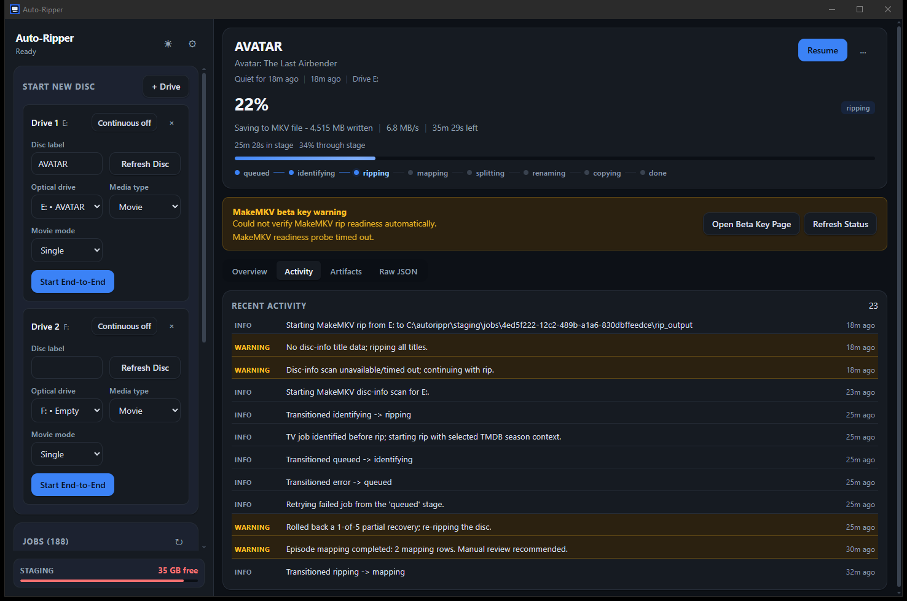

# Auto-Ripper

Automated DVD and Blu-ray ripping for a Plex-style media library.

Put a disc in the drive and Auto-Ripper identifies it against TMDB, rips only
the titles you actually want, maps them to episodes, splits combined episodes,
renames everything to Plex naming conventions, and copies the result to your
NAS — resuming cleanly if anything is interrupted.

> **Status:** active development, Windows-only for now. Expect rough edges.

[](https://ko-fi.com/vanwardawg)



---

## What it does

| Stage | What happens |
| --- | --- |
| **Identify** | Reads the disc label and menu, searches TMDB, and scores candidates. Falls back to DVD-menu OCR when the label is uninformative. |
| **Rip** | Scans the disc with MakeMKV, selects the titles worth keeping, and rips them — skipping trailers, logos, and duplicate angles. |
| **Map** | Matches ripped titles to TMDB episodes using duration, chapter counts, and menu text. |
| **Split** | Detects "two episodes in one title" discs and splits them on chapter boundaries with ffmpeg. |
| **Rename** | Applies Plex naming (`Show (Year)/Season 01/Show - s01e02 - Title.mkv`). |
| **Transfer** | Copies to your NAS with retries, checksum verification, and `.part` staging. |

Every stage is resumable, and anything the automation is unsure about is
surfaced in the UI for a one-click override rather than being guessed at.

## Requirements

Auto-Ripper is a coordinator — it drives external tools rather than bundling
them. You need these installed before it can rip anything:

| Tool | Required | Purpose |
| --- | --- | --- |
| [MakeMKV](https://www.makemkv.com/) | **Yes** | Reads and decrypts discs. The free beta key works but expires periodically; Auto-Ripper warns you before it does. |
| [ffmpeg / ffprobe](https://ffmpeg.org/download.html) | **Yes** | Probes title metadata and splits combined episodes. |
| [TMDB API key](https://www.themoviedb.org/settings/api) | **Yes** | Identifies discs. Free for personal use. |
| [Tesseract OCR](https://github.com/UB-Mannheim/tesseract/wiki) | Optional | Reads episode titles off DVD menus and title cards when the disc label is useless. |
| [VLC](https://www.videolan.org/) | Optional | Captures DVD menu screenshots for that OCR when installed. |

Auto-Ripper **does not redistribute MakeMKV or ffmpeg**. It detects them on
first run and tells you what's missing.

## Install

Download the latest Windows installer from
[Releases](https://github.com/VanWardawg/auto-dvd-rippr/releases) and run it.

> **SmartScreen warning:** releases are not code-signed yet, so Windows will
> show "Windows protected your PC". Click **More info → Run anyway**. Verify
> the download against `SHA256SUMS.txt` from the same release if you want to be
> careful.

On first launch, Auto-Ripper walks you through pointing it at MakeMKV, ffmpeg,
your TMDB key, and your staging and NAS folders. It auto-detects the tool paths
where it can.

## Usage

1. Pick the drive and tell Auto-Ripper whether the disc is a **movie** or **TV**.
2. Insert the disc and hit start — or turn on **continuous mode** and it will
   start automatically each time you load a new disc.
3. Watch progress. If identification or episode mapping is ambiguous, the job
   pauses and asks; otherwise it runs straight through to your NAS.

Configuration lives in `%APPDATA%\Auto-Ripper\config.json`, editable from the
in-app Settings tab.

### When the drive misbehaves

Optical drives fail in ways that have nothing to do with the disc, and
Auto-Ripper retries those on its own rather than waiting for you:

- **The drive loses the disc** (it could not open it, or reported the tray open
  partway through): the rip starts again after 2 minutes, then 4, 8, 16 and
  every 30 after that, up to 8 times. It keeps waiting as long as the same disc
  is in the drive or the drive shows none, and stops if a different disc goes
  in.
- **The rip fails partway for another reason:** it is started over once.
- **The rip stalls** on an unreadable spot: it is stopped after 15 minutes
  with nothing written, and not retried — the same spot would stall it again.

All four numbers are in Settings. Each attempt's MakeMKV log is kept in the
job's `logs` folder as `makemkv.attempt-N.log`.

### Notifications

Auto-Ripper can tell you when a job needs you, so you do not have to watch it.
Set **Notification webhook URL** in Settings and it will POST a small JSON
document to that URL when a job stops to ask something, fails, or finishes:

```json
{
  "app": "Auto-Ripper",
  "event": "needs_attention",
  "title": "Auto-Ripper needs you",
  "message": "HARRY_POTTER_2: confirm which movie this is. It is ripping meanwhile.",
  "job_id": "…",
  "disc_label": "HARRY_POTTER_2",
  "status": "ripping"
}
```

`event` is one of `needs_attention`, `failed`, `finished` or `test`. Anything
that accepts a POST will do — ntfy, Node-RED, a chat webhook behind a small
relay. For Home Assistant, create an automation with a **Webhook** trigger and
use its URL (`http://<your-ha-host>:8123/api/webhook/<webhook id>`):

```yaml
triggers:
  - trigger: webhook
    webhook_id: pick-a-long-random-id
    allowed_methods: [POST]
    local_only: true
actions:
  - action: notify.mobile_app_your_phone
    data:
      title: "{{ trigger.json.title }}"
      message: "{{ trigger.json.message }}"
```

Add a condition on `trigger.json.event` if you only want some of them. The
webhook URL works like a password — anyone who has it can trigger the
automation — so keep `local_only` on, and note that Auto-Ripper stores the URL
only in your local `config.json` and never writes it to a log. **Save and send
a test** in Settings confirms it works. Leave the field empty for no
notifications.

### Command line

The desktop app is a front end over a full CLI, which is useful for debugging
and scripting. From a source checkout:

```bash
py -3.11 app/main.py --config "%APPDATA%\Auto-Ripper\config.json" validate-config
```

An installed copy has the same CLI as
`resourcesackendutorippr-backendutorippr-backend.exe` inside the
install folder.

See [`wiki/usage-cli.md`](wiki/usage-cli.md) for the full command reference.

## Building from source

```bash
git clone https://github.com/VanWardawg/auto-dvd-rippr.git
```

You need Node 20+, Rust (stable), and Python 3.11.

```bash
py -3.11 -m pip install -r requirements-dev.txt
```

```bash
cd frontend && npm ci
```

Run in development mode — this uses `app/main.py` directly, so backend edits
take effect without a rebuild:

```bash
npm run tauri -- dev
```

Build a release installer:

```bash
npm run tauri -- build
```

(The build regenerates the bundled Python backend automatically, so an
installer can never ship a stale one.)

This produces both an `.msi` and an NSIS `-setup.exe` under
`src-tauri/target/release/bundle/`.

> Use `npm run tauri`, not `npx tauri` directly — the wrapper supplies the local
> Tauri CLI when none is installed globally.
>
> Avoid checking out into a cloud-synced folder (OneDrive, Dropbox). Their sync
> engines hold build output open, which fails bundling with
> `Access is denied (os error 5)` after a successful compile. The wrapper works
> around it by building outside the sync root, but keeping the repo out of sync
> is simpler and avoids uploading gigabytes of build artifacts.

Run the backend tests:

```bash
py -3.11 -m unittest discover -s app/tests -t app/tests
```

## Documentation

- [`CONTRIBUTING.md`](CONTRIBUTING.md) — how to build, test, and what the conventions are
- [`SECURITY.md`](SECURITY.md) — what the app touches, and how to report a vulnerability
- [`CLAUDE.md`](CLAUDE.md) — architecture and conventions, for contributors and AI assistants
- [`wiki/`](wiki/) — setup, CLI usage, debugging, testing
- [`specs/`](specs/) — design specifications
- [`tasks/`](tasks/) — implementation task breakdown

## Legal

Auto-Ripper is a workflow tool. It contains no decryption code and ships no
third-party ripping software — MakeMKV does that work, under its own license.
You are responsible for ensuring that ripping a given disc is lawful where you
live. This project is intended for making personal backups of media you own.

## License

[Apache License 2.0](LICENSE).
